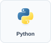
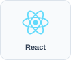
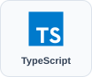
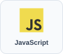
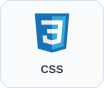
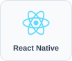
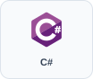

# Luis Fernando Jose Gutierrez Davila

**Full-stack developer · Web & Mobile** · `@Luigui789`

[LinkedIn ↗](https://www.linkedin.com/in/luis-fernando-jos%C3%A9-guti%C3%A9rrez-d%C3%A1vila-9ab324383/) · [Repositories ↗](https://github.com/Luigui789?tab=repositories) · [Español](README.md) / English

I develop web and mobile applications and am nearing completion of my Systems Engineering degree at **Universidad Nacional de Ingeniería (UNI)**.

**Open to remote and on-site opportunities.**

## Experience

- Developing a **web and mobile application** as a full-stack programmer.
- Assisting with **Oracle Simphony** system configuration.
- Approximately **6–7 months in a part-time role**, following a **3-month internship** at the same organization.

## Technologies

**Backend and data**

&nbsp; &nbsp; &nbsp; 

**Frontend**

&nbsp; &nbsp; &nbsp; &nbsp; &nbsp; 

**Mobile**

**Basic knowledge**

&nbsp; 

## Selected projects

### [ArtesaNic ↗](https://github.com/Luigui789/ArtesaNic)

**Thesis project** · React, TypeScript, Django REST Framework and PostgreSQL.

A system for marketing artisan products from small and medium-sized businesses in Masaya, with documentation, tests and Docker Compose. In development: accounts, authentication and permissions in the backend; frontend business flows still use mock data.

### [Software2 ↗](https://github.com/Luigui789/Software2)

**Barbershop management** · Python, Django, JavaScript, HTML and CSS.

I developed an application to manage customers, barbers and services, with queues using **Django Channels and WebSockets**.

### [Componentes S.A. ↗](https://github.com/Luigui789/ComponentesS.A)

**Business website** · Astro, Tailwind CSS and TypeScript.

I developed a website with service, solution, industry and contact pages, organized into reusable components.

## Education and languages

- **Systems Engineering · UNI**, nearing completion.
- Computer maintenance course.
- Spanish · English at **A1** level, currently learning.

---

Open to employment and collaboration on web and mobile projects. [Contact me on LinkedIn ↗](https://www.linkedin.com/in/luis-fernando-jos%C3%A9-guti%C3%A9rrez-d%C3%A1vila-9ab324383/)
